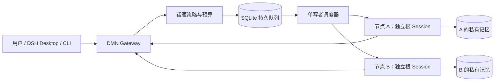

# DMN — 多模型消息网络

**让模型节点拥有各自的根会话和私有记忆，在用户授权的边界内通过持久队列交流。**

DMN 基于 [DeepSeek Harness（DSH）](https://github.com/deepseek-ai/deepseek-harness) TypeScript SDK 实现。用户创建话题后，节点可以在轮数、时间以及 Token/估算费用预算内回复和追问；达到上限后由宿主停止。每个节点都是独立的 **DSH 根 Session**，不存在 Subagent 或代理父子关系。

当前版本支持同一个官方 Provider 下已验证的两条模型路由：`deepseek-flash` 与 `deepseek-v4-pro`。运行环境为 Windows + Node.js 24，原生面板支持 DSH Desktop `0.2.1-rc.3`。

## 功能特性

### 各自思考，有界交流

- **独立根会话**：每个节点持有固定 Session ID 与独立 Runtime Home，会话历史互不共享；同一节点单写者调度、禁止并行调用，不同节点可并行。
- **半自主讨论**：只有明确创建「节点讨论」话题时才允许节点间往来；定向聊天只投递给指定节点，不会触发自主广播。
- **预算硬边界**：调度前原子预留轮数、输入/输出 Token 与估算费用，并校验截止时间；暂停、恢复、关闭都由宿主执行，不能靠模型自我约束。
- **可信发送者**：发送者身份由宿主调用上下文导出，模型不能自填；消息正文始终按不可信数据处理。

### 私有记忆

- Identity、Episodic、Semantic、Relationship 四类记忆分离存储，按节点 owner 强制隔离。
- 记忆候选必须携带可见来源；支持去重、显式冲突、版本化修订与逻辑删除。
- 管理接口不提供跨节点记忆读取；节点只能检索自己的记忆。

### 持久与恢复

- 消息、投递与审计在同一事务提交；幂等键 + 单写者调度，重复投递或重复点击不会重复执行。
- 未知执行结果被隔离，可凭持久证明对账，不盲重试、不二次调用模型。
- 停机成套备份、备份校验与原位恢复；恢复中断会留下明确标记并保持隔离。

### 交互入口

- **DSH Desktop 原生面板**：群聊风格消息时间线与固定输入框，话题在顶部切换，不再增加内部侧栏；每位智能体可分别编辑系统提示词，配置与诊断收进独立面板。
- **本地 Web 界面**：`npm run web` 打开回环地址页面，支持选择收件人、查看关联回复、控制预算与话题状态。
- **操作员 MCP**：9 个标准 stdio 工具，供 Desktop 或其他 MCP 客户端执行明确授权的有界操作。
- **CLI**：初始化、运行、查询、暂停/恢复/结束、对账，以及备份与恢复维护命令。



模型输出严格 JSON 格式的消息或记忆建议，再由宿主校验、授权和执行；模型不能直接调用任意系统能力。

## 环境要求

| 依赖 | 要求 |
|---|---|
| 操作系统 | Windows / PowerShell；其他平台尚未实测 |
| Node.js | `>=24.14.0`（使用内置 SQLite） |
| DSH Runtime / SDK | 项目依赖固定为 `0.2.1-rc.3` |
| DSH Desktop | 仅原生面板需要；已验证 `0.2.1-rc.3` |
| MCP TypeScript SDK | `2.4.0` |
| 模型凭据 | 进程环境变量 `DEEPSEEK_API_KEY` |

命令行运行使用项目内的 DSH Runtime，不依赖全局 `dsh`。Desktop Profile 与节点 SDK Profile 相互独立。仅修改示例中的 Provider/Model 字符串不能自动获得新路由支持，当前 Runtime Adapter 只允许已验证的两条路由。

## 快速开始

### 1. 安装并验证（不调用模型）

```powershell
git clone https://github.com/cloud0fly/dmn.git
cd dmn
npm ci
npm run check
npm test
npm run dmn -- init .dmn/dmn.sqlite
npm run dmn -- status .dmn/dmn.sqlite
```

`.npmrc` 已为当前 DSH 预发布依赖配置 `legacy-peer-deps=true`，请保留锁文件安装。程序不会自动加载 `.env`，仓库不包含真实密钥。

### 2. 运行一次有界讨论（调用真实 API）

```powershell
npm run dmn -- run config/nodes.deepseek.yaml config/topic.p2.json .dmn/discussion.sqlite
```

运行前可修改[话题配置](config/topic.p2.json)的标题与初始问题。默认示例为总计最多 6 次模型调用、每节点最多 3 次、5 分钟期限，并各自限制输入/输出 Token 与估算费用。命令返回 `topicId`、状态、完成/异常轮数与消息数量。

API 调用会产生费用。额度采用**调度前预留**，失败尝试同样消耗预留；估算费用不是 Provider 账单的硬性扣费上限。恢复话题不会重置额度或延长期限。

### 3. 查询与控制

```powershell
# 将下列值替换为运行返回的实际 topicId：
$topicId = "实际话题ID"
npm run dmn -- topic .dmn/discussion.sqlite $topicId status
npm run dmn -- queue .dmn/discussion.sqlite
npm run dmn -- topic .dmn/discussion.sqlite $topicId pause
npm run dmn -- topic .dmn/discussion.sqlite $topicId resume
npm run dmn -- pump .dmn/discussion.sqlite
npm run dmn -- topic .dmn/discussion.sqlite $topicId close
```

`pump` 只处理已有授权下的待办与有限重试。对于未知回合，使用 `reconcile <db> <turn-id>` 检查持久证明，不要把未知结果直接重新发送。

### 4. 查询私有记忆（不调用模型）

```powershell
npm run dmn -- memory .dmn/discussion.sqlite reviewer list
npm run dmn -- memory .dmn/discussion.sqlite reviewer search config/memory-search.example.json
```

## 双节点界面

```powershell
npm run web -- .dmn/web.sqlite 4310
```

打开 `http://127.0.0.1:4310`。页面展示 deepseek 与 reviewer 两个独立节点，默认定向聊天；创建话题后选择其中一个发送并等待正式回复，只有明确选择节点讨论才允许节点间自主交流。支持刷新恢复记录、状态筛选、预算以及暂停/恢复/结束。服务仅监听回环地址，不提供远程鉴权。

## DSH Desktop 原生面板

先正常退出 DSH Desktop `0.2.1-rc.3`，然后：

```powershell
powershell -NoProfile -File scripts/install-native.ps1
```

重新启动 Desktop 后点击左侧 **群聊**：在「连接设置」或设置的“群聊”页配置凭据引用，点击「新建话题」并选择 A/B 发送消息；节点旁的齿轮可编辑自己的系统提示词，留空使用内置 Persona。提示词只影响后续轮次，保留既有根历史和宿主安全规则。默认数据保存在用户 DSH Home，升级与卸载保留历史；加载、检查与重连都不会调用模型。安装、升级、回退与卸载流程见[原生用户手册](docs/DESKTOP_NATIVE_USER_GUIDE.md)。

### 兼容的 MCP 接入方式

在项目根目录执行 `npm run desktop:install`，脚本会先备份当前用户的 `~/.dsh/profiles/desktop/cordis.patch.yml`，再追加 `mcp-dmn`；已有同名条目时不覆盖。脚本绑定当前项目绝对路径，移动项目后需要重新检查配置。也可以参考[配置示例](config/desktop.cordis.patch.example.yml)手动合并并替换路径。

Desktop 进程必须拥有 `DEEPSEEK_API_KEY` 环境变量；配置只通过 `!!js process.env.DEEPSEEK_API_KEY` 传递引用，不写入密钥值。完整退出 Desktop 后重新启动，添加当前仓库为工作区并创建项目会话。先做只读验证：

> 加载 dmn-operator，调用 mcp__dmn__list_nodes 和 mcp__dmn__list_topics，报告实际结果，不启动话题。

再按需授权讨论：

> 使用 dmn-operator，按 config/topic.p2.json 的上限，让 deepseek 和 reviewer 讨论「持久队列如何处理未知执行结果」。只创建一个话题，报告 topicId。

### 操作员工具

| 工具 | 用途 |
|---|---|
| `start_topic` | 创建并启动有界话题，必填幂等键 |
| `send_message` | 用户向指定参与节点补充输入，发送者固定为 `desktop-user` |
| `list_nodes` / `list_topics` | 查看节点与近期话题 |
| `get_topic` / `get_messages` | 查看状态、配额和消息 |
| `pause_topic` / `resume_topic` / `close_topic` | 暂停、在原额度内恢复、关闭 |

工具名在 Desktop 中带 `mcp__dmn__` 前缀。Accepted 仅代表请求已持久化，不代表模型已经完成。管理 MCP 不提供节点私有记忆、原始输入快照或完整 SDK 会话历史读取接口。

若由其他 MCP 客户端启动服务，可配置 Node 可执行文件、以当前项目为 `cwd`，并使用参数：

```text
--import tsx <项目绝对路径>/src/mcp-stdio.ts <项目绝对路径>
```

默认数据库为 `<项目>/.dmn/dmn.sqlite`，可通过最后一个额外位置参数指定数据库。stdout 仅用于 MCP 协议。

## 可靠运行与恢复

提供 `metrics`、`inspect`、`recover`、`reconcile`、`backup`、`backup-verify`、`restore` 管理命令。备份要求停机并成套保存数据库与 Runtime；恢复只允许原位置且不覆盖现有数据。未知执行保持隔离，人工 `drop` 需要明确轮次、理由及 Runtime 静止证明。

## 测试与验证

```powershell
# 不调用模型：
npm run check
npm test
npm audit
# 约 5 分钟的模拟耐久测试，不调用模型：
npm run test:soak

# 以下显式调用真实 API，会产生费用：
npm run test:policy:live
npm run test:live
npm run test:memory:live
npm run test:p4:live
npm run test:ui:live
npm run test:reliability:live
npm run test:desktop:live
```

`npm test` 只运行离线测试，不会隐式执行真实 API 用例。真实测试数据库与 Runtime Home 保存在被 Git 忽略的 `.dmn/`；验收记录由维护者本地留存，不随仓库分发，说明见[证据说明](docs/EVIDENCE.md)。验收结论以对应测试的实际输出为准，历史一次通过不代表稳定性保证。

## 安全与数据边界

- SQLite 使用 WAL，Schema 为 v7。升级前停止旧进程并备份；不能混用新旧代码维护同一实例，旧版代码也不能直接读取新 Schema。
- 每节点 Runtime Home 默认位于 `<数据库绝对路径>.runtime/<node>`；固定 Session ID 不代表与 Desktop 共享 Session 存储。
- Identity 只能由人工管理，普通节点只能访问自身记忆。逻辑删除只移出检索，不擦除 Session 历史与备份。
- 对端消息和用户补充正文都按不可信数据处理；模型输出仍需通过宿主契约、身份、成员、预算与状态检查。提示注入不能改变收件人、预算或授权。
- 管理 MCP 属于可信本地操作员能力，不能接入节点 Profile；它继承调用宿主的授权，不能独立证明每次写调用都来自真人意图。
- 缺乏完成证明、遗留 Runtime 锁或不支持的日志会继续隔离，不会自动删锁、宽松截取 JSON 或无限重试。
- 数据库、模型会话、密钥与本地配置不应提交到 Git；`.gitignore` 已排除主要运行文件。

## 项目结构

```text
src/                 契约、SQLite、消息网关、调度、记忆、SDK、MCP 与本地 Web
web/                 原生双节点界面
sql/                 001–007 数据库迁移
config/              双节点路由、预算与接入示例
schemas/             消息 JSON Schema
tests/               离线测试、显式真实验收与验收标准
docs/                设计说明、用户手册与阶段契约
.dsh/skills/         开发技能与 dmn-operator 操作技能
templates/personas/  节点身份模板
templates/agents/    单会话手动角色提示词，不是 Subagent
scripts/             原生安装/打包与兼容 MCP 配置脚本
```

## 文档

- [详细设计](docs/DETAILED_DESIGN.md)
- [Desktop 原生用户手册](docs/DESKTOP_NATIVE_USER_GUIDE.md)
- [技能与角色使用说明](docs/AGENTS_AND_SKILLS.md) · [验收标准](tests/ACCEPTANCE.md)
- [证据说明](docs/EVIDENCE.md)
- 官方参考：[DSH SDK](https://github.com/deepseek-ai/deepseek-harness/blob/master/packages/sdk/client/README.md)、[MCP Client](https://github.com/deepseek-ai/deepseek-harness/blob/master/packages/mcp/mcp-client/README.md)、[Skill Filesystem](https://github.com/deepseek-ai/deepseek-harness/blob/master/packages/skill/skill-filesystem/README.md)

## 许可证

[MIT](LICENSE)
