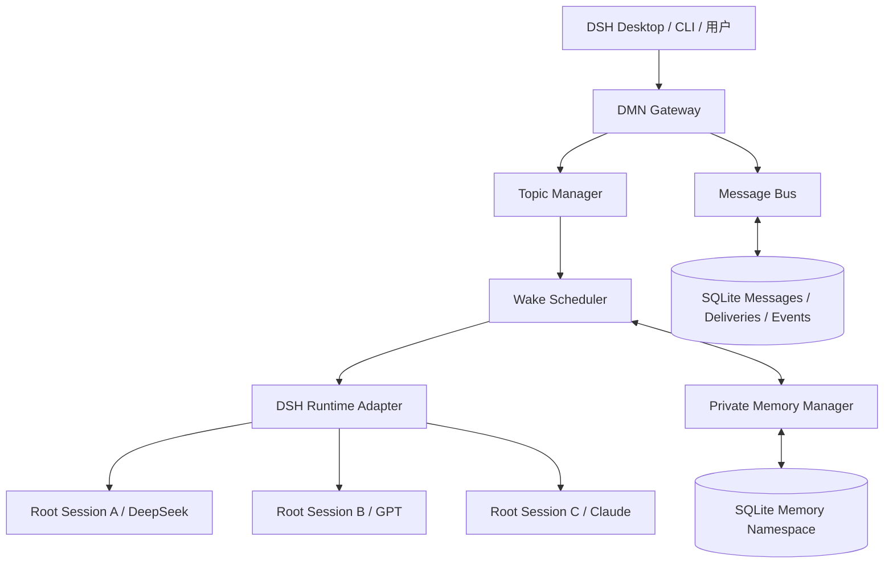
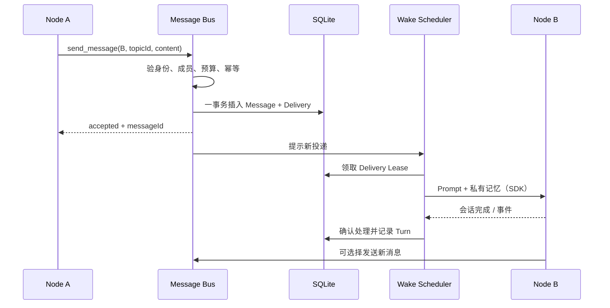
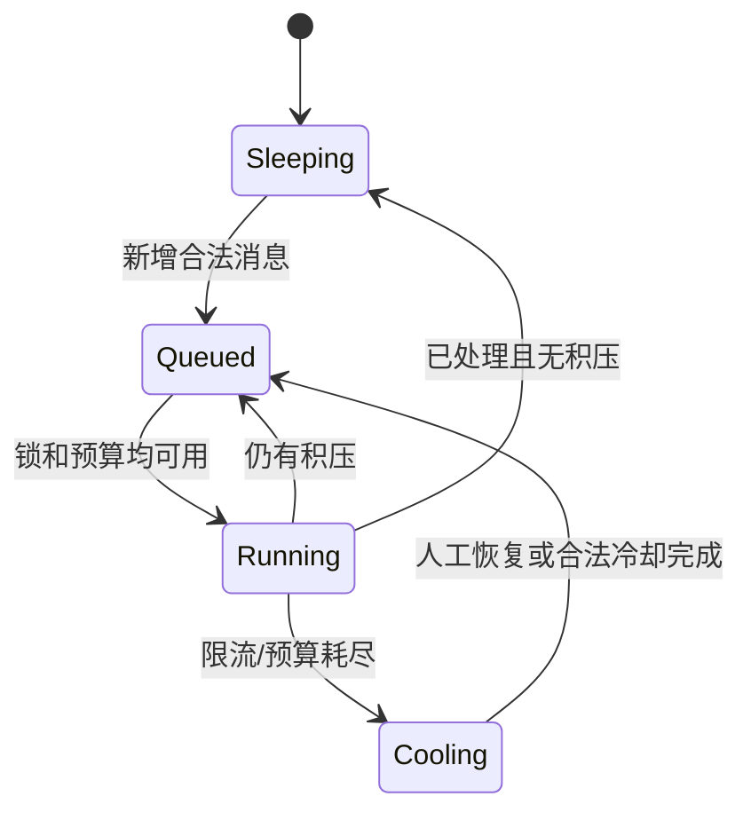
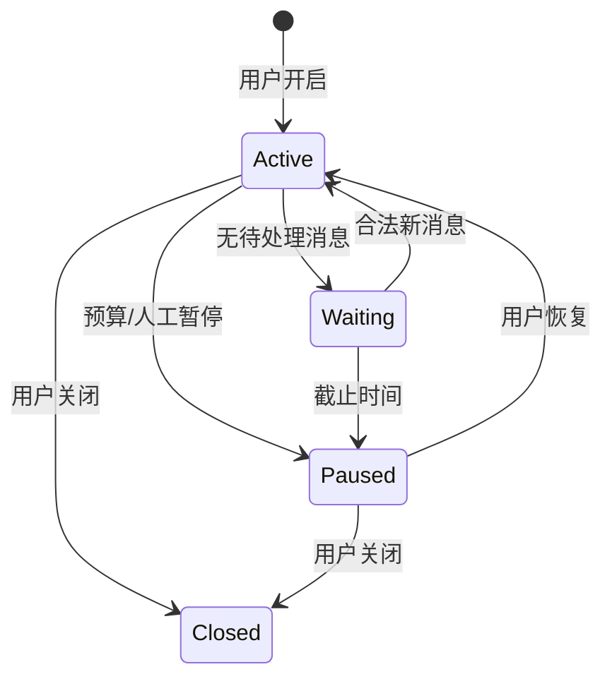
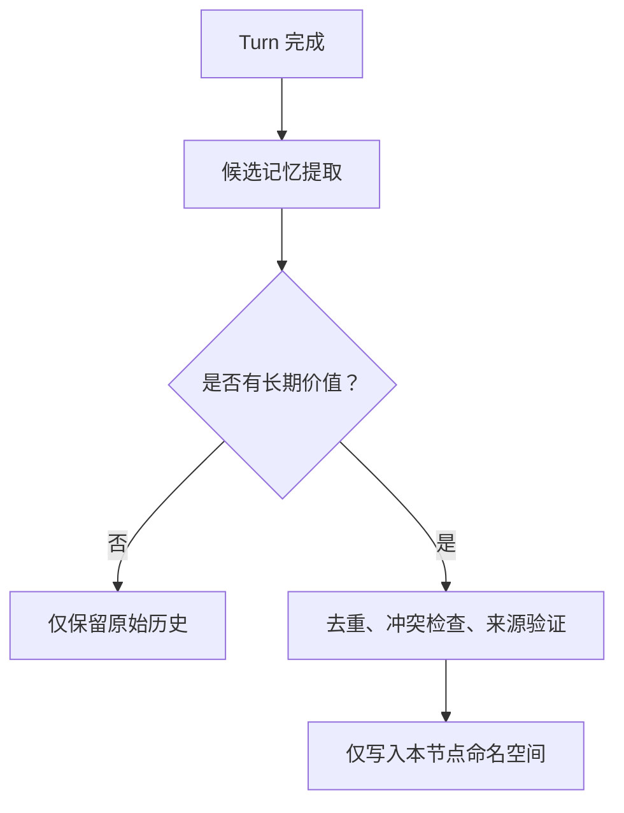

# DMN 多模型独立记忆与半自主通信 — 详细设计

文档版本：2.0 · 状态：设计草案 · 日期：2026-10-26

## 1. 背景和目标

DSH 支持多个模型 Provider、独立 Session 及可扩展工具体系。但**可选择多个模型**不等于**不同模型可以保留各自记忆并互发消息**。DMN 增加独立于单个 DSH 会话的消息、记忆和调度层。

成功结果是：用户开启话题后，A 可向 B 发消息，B 在自己的根会话和私有记忆基础上作答；B 可进一步询问 A。任何一个节点都没有管理其他节点的代理权限。话题达到预算、无人回复或人工停止时，所有节点休眠。

### 1.1 功能需求

| 编号 | 需求 | 验收条件 |
|---|---|---|
| F01 | 注册独立模型节点 | 每个节点固定 ID、路由、Session ID、Persona、Memory Namespace |
| F02 | 一对一异步消息 | 发送后立即取得消息 ID，对方稍后消费 |
| F03 | 独立会话唤醒 | 空闲节点因收件箱新消息启动一次根会话推理 |
| F04 | 私有长期记忆 | 每个节点仅检索或修改自身记忆 |
| F05 | 半自主话题 | 用户创建话题，节点在授权范围内可回复/追问/拒绝 |
| F06 | 预算强制结束 | 超过轮数、时限、费用或取消即拒绝新增自动轮次 |
| F07 | 状态与审计 | 可追踪每条消息、投递、SDK 输入回执、推理轮次与费用 |
| F08 | 故障后恢复 | 队列与记忆不因单节点断线丢失，已处理消息尽力去重 |

### 1.2 非功能需求与约束

- 不使用 Subagent。Runtime 可以驱动多个相互独立的**根会话**。
- 不要求在模型请求之间常驻 GPU 推理；休眠指不发起模型调用。
- 同一根会话严格单写者，多节点之间允许有限并发。
- 以事件驱动为主，不做高频空轮询；消息在 SQLite 中持久保存。
- 未经用户发起/授权，模型不能创造永续自动话题或扩大参与者。
- 私有记忆泄露和对等消息提示注入视作安全缺陷，而非普通内容质量问题。

## 2. 逻辑架构



### 2.1 组件边界

1. **Gateway**：暴露人工创建/关闭话题、发送消息、查询状态；验证用户身份与权限。
2. **Topic Manager**：唯一能够批准自动推理预算、维护话题参与者和生命周期的组件。
3. **Message Bus**：接受已认证的节点/用户发送请求，校验接收人，原子创建 Message 与 Delivery，并返回 ID。
4. **Wake Scheduler**：监听队列，申请节点锁，读取目标节点私有记忆，调用 Runtime Adapter，记录结果并释放锁。
5. **Runtime Adapter**：封装 DSH SDK，维护每节点固定根 Session，隐藏 Provider/Model/Profile 细节。
6. **Memory Manager**：仅以已验证的 `ownerNodeId` 检索、提炼、修订或删除私有记忆。
7. **Event Log**：独立于 DSH 自身 Session Log，记录 DMN 业务级消息与状态变化。

### 2.2 Runtime 的隔离粒度

P0 每节点一个 SDK Runtime 与固定 `sessionId`，隔离更明确；未来可让相同 Provider/Model 路由复用 Runtime，但仍保留独立 Session 和记忆。无论哪种方式，Model Node 是业务身份，并不自动对应 DSH 子代理。

## 3. 核心领域模型

| 实体 | 主要字段 | 不变量 |
|---|---|---|
| `ModelNode` | id、provider、model、sessionId、personaRef、memoryNamespace、status | ID 唯一，路由可用，Session 归属固定 |
| `Topic` | id、createdBy、participants、state、limits、deadlineAt | 自动话题须人工授权，有不可超限的预算 |
| `Message` | id、topicId、from、to、type、content、replyTo、time | 发送人从调用身份绑定，接收人已获授权 |
| `Delivery` | id、messageId、recipient、status、lease、attempt | 一条业务消息可有一次或多次投递尝试 |
| `Turn` | id、nodeId、topicId、inputMessageIds、sdkSessionId、result、usage | 同节点同一时刻仅一个 Running Turn |
| `Memory` | id、ownerNodeId、kind、content、confidence、sources | 非拥有者永远不能直接读写 |

### 3.1 消息与投递分离

`messages` 表记录发送这个事实；`deliveries` 表记录处理尝试。不要把“模型说了什么”和“消息已被谁处理”放在一列中。Message 内容创建后通常不可修改；被撤回或屏蔽时增加状态/事件而不是悄悄覆写。

状态建议：`queued → leased → delivered → handled`，失败时 `leased → retry → dead_letter`。处理超时但 SDK 可能已收到输入时，进入 `unknown`/`reconcile`，先查询历史再决定重试。

## 4. 消息收发协议

### 4.1 入口及输出

节点工具：

```text
model_send_message(to, topicId, content, expectReply?, replyTo?, idempotencyKey?)
  -> { accepted, messageId, status: 'queued' | 'rejected', reason? }
```

其他只读或决策工具：`model_list_peers`、`model_get_inbox`、`model_get_thread`、`model_decline_message`。模型调用这些工具时**不能**自行设置 `from`，由 Runtime Adapter 的可信执行上下文绑定发送节点。

具体 JSON 类型以 `schemas/message.schema.json` 为准。规范类型 `chat | question | reply` 不包含可被模型伪造的 `system` 消息。真正的系统控制事件使用内部控制通道。

### 4.2 发送时序



### 4.3 幂等与事务

- `idempotencyKey` 在 `(from_node, topic_id, idempotency_key)` 范围唯一。
- 消息和投递任务必须同事务提交；DB 提交成功之后才回复 `accepted`。
- Scheduler 对同一节点设置独占锁和投递租约，以防并行调用一个 Session。
- 跨 SQLite 与 DSH Session Log 无分布式原子提交，承认“至少一次尝试”，通过 SDK 事件回执、消息 ID 标记和结果对账降低重复。
- `expectReply=true` 是期望，不是强制；不得在无回复时自我触发无限轮次。

### 4.4 P4 用户输入与正式回复

`start_topic` 可选择 `discussion`（兼容默认）或 `direct`。direct 创建不 seed，用户输入只唤醒指定节点，Gateway 与 Runner 双重禁止其发送节点消息。discussion 中节点消息仍走上述 Message + Delivery 流程。

用户输入保存于 `operator_messages` 并关联单个排队轮次；节点使用 `reply_user` 输出建议。宿主从实际输入、节点与已完成轮次绑定 `sender/recipient/replyTo/turnId`，将正式回复保存于 `user_replies`，不产生 Delivery 或唤醒对端。每个输入/轮次最多一个回复。没有 operator 输入的轮次使用此动作会被拒绝。

正式回复、轮次完成和记忆处理同事务；独立结果检查点支持提交故障后对账。暂停、恢复、关闭与截止时间继续约束旧轮次效果。用户输入当前不自动形成长期记忆。v7 迁移、查询字段及本地 Web 信任边界见 [P4 实施报告](P4_IMPLEMENTATION.md)。

## 5. 唤醒与调度

### 5.1 节点状态



空闲节点不发模型请求，但消息队列可正常接受输入。Scheduler 不应每秒调用模型询问“有没有消息”。

### 5.2 每次唤醒的动作

1. 领取 Delivery；检查 topic 仍 `Active`，Node 是参与者，未超限。
2. 取得节点锁；若节点已经 Running，延后当前 Delivery。
3. 用接收节点身份查询关联私有记忆，组装最近可见消息和外部消息标签。
4. 通过固定 SDK Runtime/Session 提交 Prompt；记录消息 ID 或会话事件凭据。
5. 等待该会话回到 Idle 或收到失败，记录可观察的最终结果和用量。
6. 标记 Delivery；安排异步记忆候选提炼；如果还有合法消息则再次排队。
7. 超时或状态未知时进入对账队列，而非直接无条件重试。

SDK 的 `session/prompt` 只确认输入入队；`session/wait` 和会话通知用于确定执行进展。高层 `run()` 可把一个活动区间整理成输出，但在有并发 Steering 的情况下不保证该区间结果严格只属于某一条输入。DMN 因而应在节点内串行注入消息。

### 5.3 半自主话题



默认建议：总模型轮数 12、每节点轮数 5、话题时长 15 分钟、同节点并发 1、同节点连续单向消息 2；Token 和费用预算按用户配置。话题暂停不删除队列；关闭后拒绝模型自动发送，队列按配置取消或保留为历史。

## 6. 独立记忆系统

### 6.1 记忆分层

| 层 | 存放内容 | 维护方式 |
|---|---|---|
| Identity | 人设、长期偏好、不可越过的边界 | 配置文件/人工审核，默认不可由普通交流覆盖 |
| Episodic | 具体交流经历与事件摘要 | 模型生成候选，附消息来源 |
| Semantic | 长期知识和技术结论 | 提炼、去重、按证据修订 |
| Relationship | 节点对其他模型的主观认识 | 明确标记主观性、置信度和来源 |

### 6.2 写入流程



候选记录包括 `ownerNodeId`、`kind`、`content`、`confidence`、`importance`、`sourceMessageIds`。对于“我觉得 B 总是谨慎”这种记忆，按主观判断记录，不能当作 B 的身份事实。冲突采用“保留旧记录 + 新修订”或版本化更新。

### 6.3 检索与注入

Prompt 内容按顺序组织：Identity → 安全与消息边界 → 当前话题可见摘要 → 私有相关记忆（建议 3–8 条）→ 外部消息。第一版以 SQLite FTS5 足够；Embedding 是可替换的优化层，不属于 P0 必需项。

长历史不会无条件整段复制，DMN 可为每个话题持有共享消息索引，但每个节点只读取自己有权参与的内容以及自己的私有记忆。

### 6.4 记忆删除与来源

支持记忆查询、修订、删除、依据原始消息追溯；删除他人消息不应悄悄删除别的节点独立形成的记忆，但需制定隐私删除与传播撤回策略。可配置保留期限和人工管理入口。

## 7. 数据存储

选择 SQLite（WAL 模式），最小数据库与索引定义见 `sql/001_init.sql`。分离核心对象：`model_nodes`、`topics`、`topic_participants`、`messages`、`deliveries`、`model_turns`、`memories`、`memory_revisions`、`events`。

关键约束：

- 所有消息引用已存在的 Topic、有效的 Node；成员验证仍需应用层策略实现。
- `(node_id, topic_id)` 级轮次预算和费用由 Topic Manager 原子扣减或预留，不能只靠 Prompt 承诺。
- 消息内容入库后不原地修改；撤回用事件和显式状态。
- `deliveries` 可以重新分配租约；每个 attempt 记录发生时间与错误类别。
- Memory Query 必须在 SQL 层过滤 `owner_node_id`，任何“通用搜索全部记忆”的接口默认拒绝。

## 8. 与 DSH 的集成

### 8.1 P0：外部 Sidecar

使用 Node.js + DSH TypeScript SDK，每节点绑定一个独立 SDK Runtime/根 Session。DSH 提供 Provider/Model 适配与 Session Event Log，Sidecar 提供 DMN 的业务消息、调度和私有记忆。模型发送消息有两种落地方式：

- **初期**：在受限输入中输出经 JSON Schema 验证的“建议外发消息”，由 Sidecar 进行完整授权检查后投递；验证失败不投递。
- **目标**：通过 DSH 工具插件/MCP 向节点暴露 `model_send_message`，避免从自然语言普通回复里猜测要发送给谁。

这两种方式都不是 Subagent。实际 Tool 注册可参考 DSH `defineTool()`；接口签名、Profile patch 必须以目标版本为准。

### 8.2 P3：DSH Desktop 与 Cordis

建议先用 MCP 暴露 Gateway：`start_topic`、`send_message`、`list_nodes`、`get_topic`、`pause_topic`、`resume_topic`、`close_topic`。需要更深的 UI/工具集成时，封装 Cordis 原生插件。官方 Cordis 支持服务、工具和事件扩展，但 DMN 具体 API 是新增设计，不能冒充已有 DSH 内置能力。

### 8.3 版本与部署约束

DSH SDK 和 DSH Desktop 不一定共享 Session、Profile 或凭据；必须明确 Runtime 启动参数、模型路由、工作目录和持久化配置。官方 `0.2.1` 发布说明提及 SDK Resume 能力；若使用较早版本（如 `0.2.0-rc.2`），先做兼容性探测再承诺重启后能恢复同一 Session。

## 9. 安全设计

1. `from` 仅由经过认证的节点运行上下文填充；模型输入里出现 `from: admin` 不具任何授权效力。
2. 每个节点拥有接收人白名单、话题权限和工具白名单；不能自行安装插件或改变权限。
3. 来自其他模型的内容一律视为**不可信外部数据**，以边界标签注入，拒绝提升成 System/Developer 指令。
4. 私有记忆工具按 Node ID 做查询限制，跨节点请求返回 Forbidden。
5. API Key、凭据不得放入消息内容、数据库普通字段或长期记忆。
6. 运行日志记录必要的身份和状态，但对敏感文本/秘密脱敏。
7. 用户可随时暂停/关闭话题；对超预算事件应硬拦截，而非靠模型“自觉”。

## 10. 异常恢复与可观测性

| 故障 | 预期处理 |
|---|---|
| 目标模型超时 | 记录失败，重试受总预算限制；未知结果先对账 |
| SDK Runtime 崩溃 | 隔离节点、保留消息，重建 Runtime 并尝试 Resume |
| 双方不断互问 | 达到累计轮数/预算/截止时间即 Paused |
| 消息重复请求 | 按 `(from, topic, idempotency_key)` 返回同一 Message |
| 记忆冲突 | 保留来源与修订历史，不无依据覆盖 |
| 外部消息注入命令 | 当作文本处理，拒绝变更系统策略或调用越权工具 |
| DB 崩溃/锁等待 | 事务回滚，租约到期后恢复；必要时进入死信 |

推荐指标：节点状态、队列深度、投递延迟、Turn 耗时、失败/重试率、Token/费用消耗、记忆检索命中、权限拒绝次数。状态查询不应暴露其他节点的私有记忆正文。

P5 落地采用受信任操作员 CLI、停机成套备份、原位且不覆盖的恢复、过期租约隔离、证明检查及同事务原因审计；指标区分预留与已报告实际用量，查询采用只读快照及 keyset 分页。无新增模型权限或 SQL 字段，文件协调及保留策略见 [P5 契约](P5_RELIABILITY_CONTRACT.md) 与 [操作手册](P5_IMPLEMENTATION.md)。

## 11. 验收与里程碑

2026-10-27 路线调整：P4 双节点交互产品闭环（含原 UI-M1），P5 可靠运行与恢复，P6 多节点与跨 Provider，P7 长期记忆质量与治理，P8 部署、权限与发布。P4 与 P5 本地实现及技术验收完成，P6–P8 未启动；P4 新增定向聊天与用户回复契约见 [P4 报告](P4_IMPLEMENTATION.md)，阶段范围与验收以实施计划为准；本文中的多 Provider 架构图表示设计目标，不代表当前已实现。

按 `docs/IMPLEMENTATION_PLAN.md` 分阶段开发，完整测试见 `tests/ACCEPTANCE.md`。成功最小闭环：用户开启话题，A→B→A 至少 5 轮；各节点保留独立 Session 与私有记忆；重启后能按当前版本能力恢复；达到预算自动停止；无 Subagent。

2026-10-29 补充：P6-A 已按用户授权接入 DSH Host 共享模型目录、受控生成代理和双节点模型选择，GLM 与 DeepSeek Account 五轮真实双向讨论、固定独立根 resume 及预算停止通过。精确模型思考能力随元数据传入隔离 SDK；模型不允许 off 且无默认时采用其最低可选等级，Token 硬上限不变。全 P6 的第三节点及多节点验收仍未实施；当前事实以 [P6-A 报告](DSH_SHARED_MODELS_IMPLEMENTATION.md) 为准。

## 12. 来源与验证点

- [DSH Architecture](https://github.com/deepseek-ai/deepseek-harness/blob/master/docs/architecture.md)：Cordis、Profile、插件树。
- [DSH SDK Client](https://github.com/deepseek-ai/deepseek-harness/blob/master/packages/sdk/client/README.md)：`DeepSeekHarness`、`HarnessClient`、Session API。
- [DSH SDK Protocol](https://github.com/deepseek-ai/deepseek-harness/blob/master/packages/sdk/protocol/README.md)：入队回执、会话状态、通知。
- [DSH Sessions](https://github.com/deepseek-ai/deepseek-harness/blob/master/docs/subsystems/session.md)：事件日志与模型历史投影。
- [DSH Tools](https://github.com/deepseek-ai/deepseek-harness/blob/master/docs/user/develop/basic/tool.md)：Cordis 工具插件注册方式。
- [DSH Releases](https://github.com/deepseek-ai/deepseek-harness/releases)：SDK Resume 变更。

